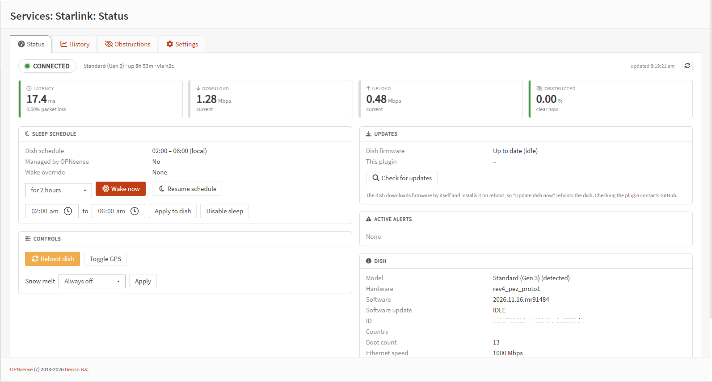
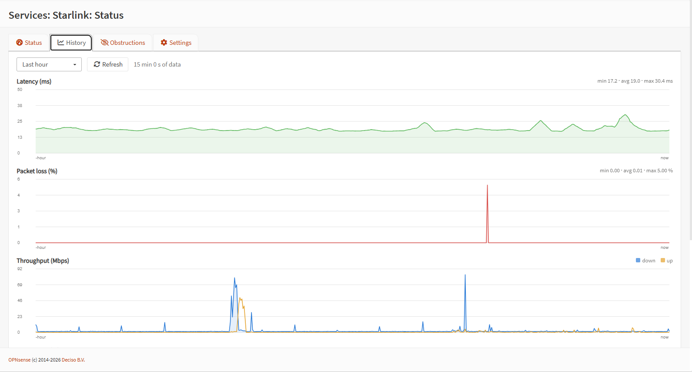
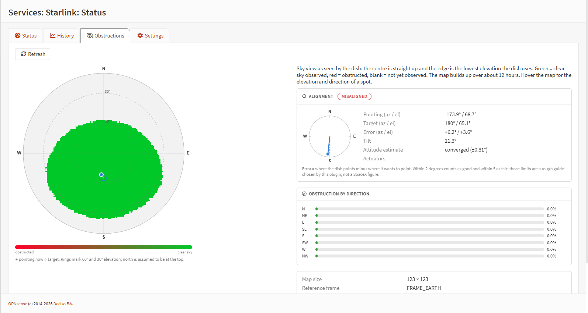
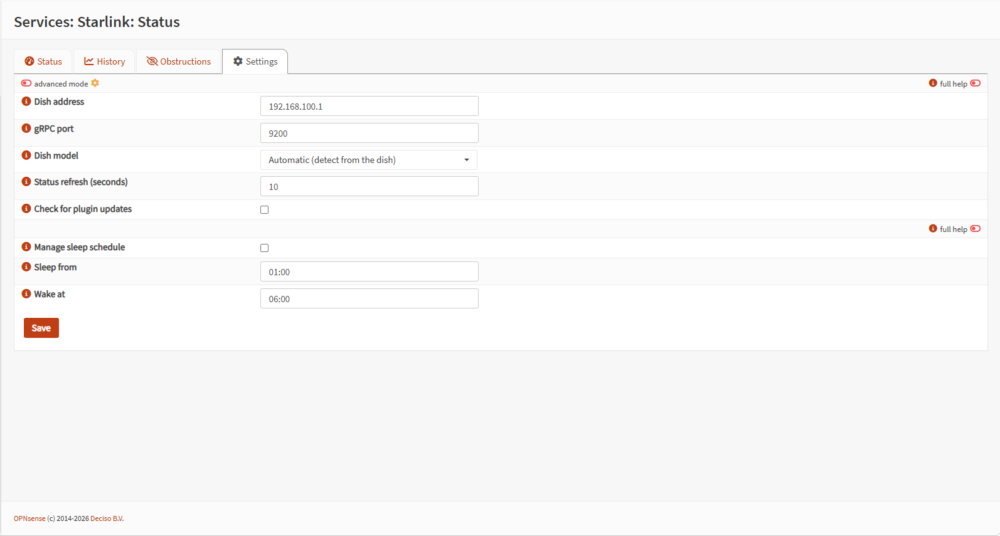

# os-starlink

An OPNsense plugin to monitor and control a SpaceX Starlink dish from the web UI.



## Features

- **Status:** state, latency, packet loss, throughput, obstruction %, alerts, firmware,
  GPS and pointing.
- **Wake now:** wakes a sleeping dish for 1 to 24 hours, or until resumed. The previous
  sleep schedule comes back automatically afterwards.
- **Sleep schedule:** set it in your local time. The dish stores it in UTC, and the
  plugin converts it.
- **Managed schedule** (optional): OPNsense owns the sleep window and re-applies it every
  5 minutes, which corrects the daylight-saving shift.
- **Controls:** reboot, stow/unstow (dishes with motors), GPS on/off and snow melt mode.
- **Updates:** shows when the dish has a firmware update ready (Update now reboots it to install) and, on request, whether a newer plugin version is on GitHub.
- **Dish model:** detected from the dish, or chosen in Settings. Controls a model does not have are hidden.
- **History:** latency, loss, throughput and power draw for up to 12 hours, plus outages.
- **Obstruction map** with an alignment readout, and **dashboard widgets**.
- **No extra packages:** it talks to the dish's local gRPC API using only the Python that
  ships with OPNsense.

## Screenshots

### History

Latency, packet loss and throughput charts with hover values and min / average / max.



### Obstructions and alignment

A polar sky map, alignment of the dish against its target, and obstruction by direction.



### Settings



## Install

SSH into OPNsense as root (choose option **8** for a shell) and run:

```sh
fetch -o - https://horizon10t.github.io/os-starlink/setup.sh | sh
```

Then go to **System → Firmware → Plugins**, click **Check for updates**, and install
**os-starlink**. It appears under **Services → Starlink**. New versions then show up as
normal plugin updates.

The script adds `/usr/local/etc/pkg/repos/starlink.conf` and the repository's signing-key
fingerprint. See https://horizon10t.github.io/os-starlink for manual steps and removal.

## Uninstall

Remove **os-starlink** under System → Firmware → Plugins. Then, to drop the repository:

```sh
rm /usr/local/etc/pkg/repos/starlink.conf
rm -r /usr/local/etc/pkg/fingerprints/starlink
```

## Licence

BSD 2-clause, see [LICENSE](LICENSE). Third-party material is listed in
[THIRD_PARTY_NOTICES.md](THIRD_PARTY_NOTICES.md).
